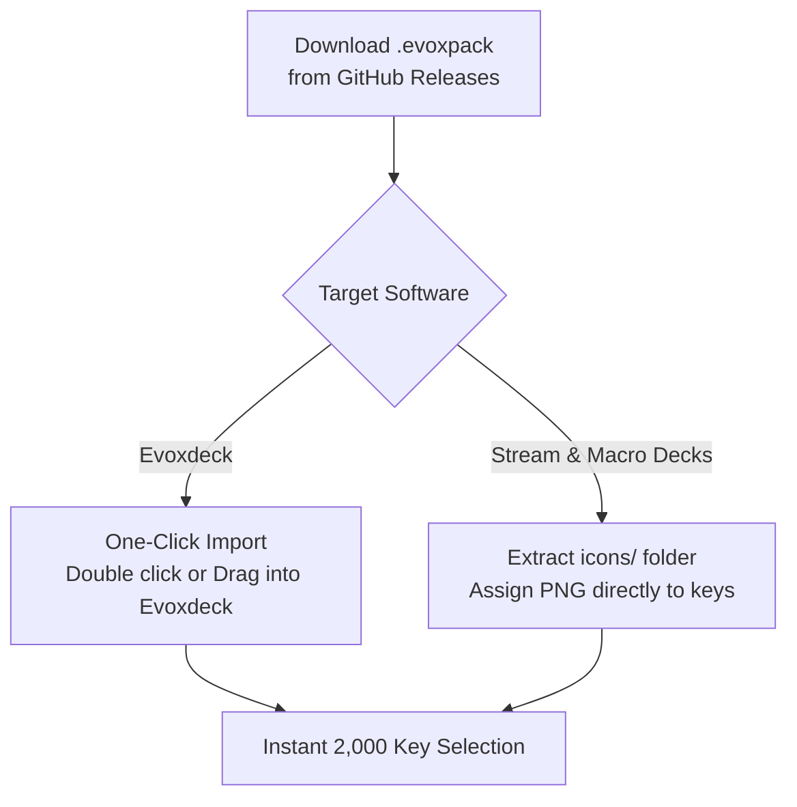

  
  <h1>Pastel Glass Icons - Vol 2 (Sunset Edition)</h1>
  
<strong>2,000 radiant pastel glass squircle icons in Pink, Red, Orange & Coral palettes for Stream Deck & Evoxdeck.</strong>

  

    <strong>Language:</strong> <a href="README.md"><strong>EN</strong></a> | <a href="README.tr.md"><strong>TR</strong></a>
    &nbsp;•&nbsp;
    <a href="https://github.com/Hfatih/pastel-icons-pack-2/releases/latest">Download .evoxpack</a> ·
    <a href="https://hfatih.github.io/pastel-icons-pack-2/">Live Interactive Gallery</a> ·
    <a href="#how-to-install">How to Install</a>
  

  

    
    
    
    
    
    
  

  

    
    
    
    
    
  

---

## Overview

**Pastel Glass Icons - Vol 2 (Sunset Edition)** is an ultra-high-definition, smooth pastel glass icon collection crafted specifically for **Stream & Macro Decks**, **Evoxdeck**, **Loupedeck**, and **Touch Portal**.

Each icon is rendered on a precision superellipse ($p=3.6, r=52$) squircle base at Retina $128\times 128$ resolution, combining airy translucent glass gradients with a subtle glass rim highlight.

### 🌐 Live Interactive Web Gallery
You can preview, search, filter and experience all 2,000 icons directly in your web browser without downloading:
👉 **[Open Live Gallery on GitHub Pages](https://hfatih.github.io/pastel-icons-pack-2/)**

---

## Showcase

| Stream Deck Live Mockup & Key Matrix |
| :---: |
|  |
| *2,000 icons across 4 pastel glass color palettes featuring clean solid white vectors and smooth glass gradients.* |

---

## Color Palettes & Swatches

| Theme Name | Slug | Top-Left RGB | Bottom-Right RGB | Hex Gradient |
| :--- | :--- | :--- | :--- | :--- |
| **Pembe (Pink)** | `pink` | `rgb(255, 220, 245)` | `rgb(254, 95, 240)` | `#ffdcf5` ➔ `#fe5ff0` |
| **Kırmızı (Red)** | `red` | `rgb(255, 215, 205)` | `rgb(252, 55, 58)` | `#ffd7cf` ➔ `#fc373a` |
| **Turuncu (Orange)** | `orange` | `rgb(255, 235, 205)` | `rgb(252, 118, 55)` | `#ffebcf` ➔ `#fc7637` |
| **Mercan (Coral)** | `coral` | `rgb(255, 224, 219)` | `rgb(255, 111, 97)` | `#ffe0db` ➔ `#ff6f61` |

---

## Curated Symbol Categories (500 Glyphs × 4 Themes)

1. **🎙️ Audio & Voice Controls:** Mic, Headphones, Volume (0-1-2-Mute), Bell, Soundlines, Waveforms, Equalizer, Mixer, Subwoofers.
2. **🎵 Media & Music:** Play, Pause, Skip, Rewind, Shuffle, Repeat, Disc, Radio, Podcast, Guitar, Camera, Video, Spotify, Apple Music, FL Studio, Audacity.
3. **⭐ Streamer Badges:** REC, LIVE, Game Audio, Music Audio, Mute, Deaf, Mic On, GG, VIP, MOD, Clutch, AFK, Hype, Sub, Chat, Poll, Clip, Trophy, Crown, Flame, Zap.
4. **🎮 Gaming & Esports:** Minecraft, Valorant, League of Legends, PlayStation, Xbox, Nintendo Switch, Steam, Epic Games, Gamepad, Joystick, Swords, Battle Axe, Bomb, Crosshair, Dices.
5. **📱 Social & Creator Platforms:** YouTube, Twitch, Discord, TikTok, Instagram, Twitter/X, Facebook, Kick, Reddit, Telegram, WhatsApp, OBS Studio, Streamlabs, Blender.
6. **⚙️ System & Hardware:** CPU, GPU, RAM, Monitor, Laptop, Mouse, Keyboard, WiFi, Bluetooth, Clock, Timer, Power, Lock, Settings.

---

## How to Install

### 1. Evoxdeck (Recommended)
1. Download `Pastel Glass Icons - Vol 2.evoxpack` from [Releases](https://github.com/Hfatih/pastel-icons-pack-2/releases/latest).
2. Double-click the file or open **Evoxdeck** ➔ **Settings** ➔ **Icon Packs** ➔ **Import Pack**.
3. All 2,000 icons and categories will appear instantly in your Evoxdeck library with search & filter.

### 2. Stream & Macro Decks
1. Extract `icons/` folder from the repository or `.evoxpack` (it's a zip container).
2. In the Stream & Macro Decks configuration software, drag and drop any PNG onto a key slot.

---

## Package Specification (`manifest.json`)

The `.evoxpack` conforms strictly to the **Evoxdeck Package Specification v1**:
- `schemaVersion`: `1`
- `packageType`: `icon_pack`
- `coverImage`: `cover.png` (256×256 Retina squircle)
- `assets/icons/`: 2,000 individual PNG icons ($128\times 128$ px, 32-bit RGBA)

---

## License

Distributed under the **MIT License**. Free for personal and commercial stream setups.
Authored with 💖 by **[Fatih Han](https://github.com/Hfatih)**.
