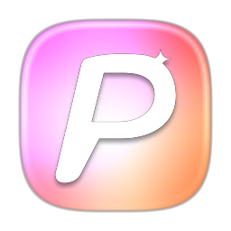
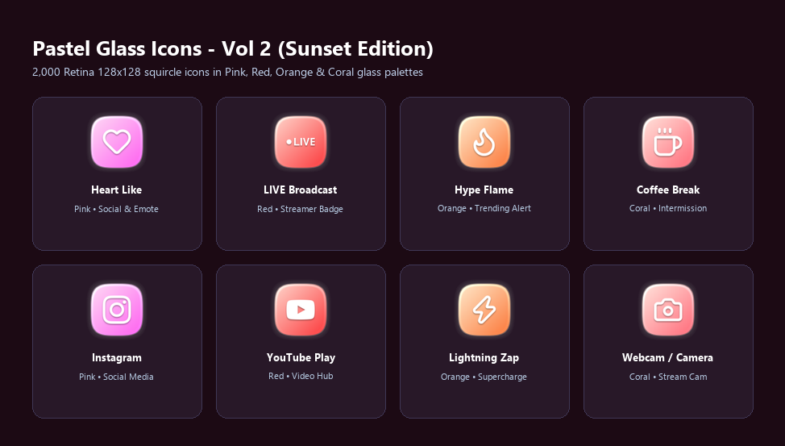
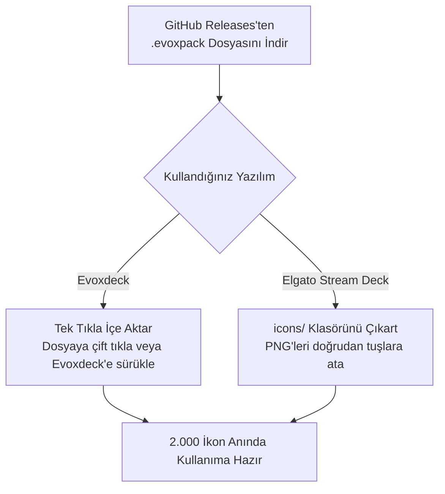

  
  <h1>Pastel Glass Icons - Vol 2 (Sunset Edition)</h1>
  
<strong>Pembe, Kırmızı, Turuncu ve Mercan Cam renk temalarında 2.000 adet estetik pastel cam Stream Deck & Evoxdeck ikon paketi.</strong>

  

    <strong>Dil:</strong> <a href="README.md"><strong>EN</strong></a> | <a href="README.tr.md"><strong>TR</strong></a>
    &nbsp;•&nbsp;
    <a href="https://github.com/Hfatih/pastel-icons-pack-2/releases/latest">.evoxpack İndir</a> ·
    <a href="https://hfatih.github.io/pastel-icons-pack-2/">Canlı Web Galerisi</a> ·
    <a href="#kurulum">Nasıl Kurulur?</a>
  

  

    
    
    
    
    
    
  

  

    
    
    
    
    
  

---

## Genel Bakış

**Pastel Glass Icons - Vol 2 (Sunset Edition)**, **Elgato Stream Deck**, **Evoxdeck**, **Loupedeck** ve **Touch Portal** cihazları için özel olarak tasarlanmış, yumuşak geçişli estetik bir pastel cam ikon koleksiyonudur.

Her ikon, Retina $128\times 128$ çözünürlükte, matematiksel süperelips ($p=3.6, r=52$) squircle taban üzerinde, zengin pastel cam gradyanlar ve parlak cam kenar yansımalarıyla hazırlanmıştır.

### 🌐 Canlı Web Deneyimi & Galeri
Hiçbir dosya indirmeden 2.000 ikonun tamamını doğrudan tarayıcınızda arayabilir, filtreleyebilir ve inceleyebilirsiniz:
👉 **[GitHub Pages Üzerinde Galeriyi Aç](https://hfatih.github.io/pastel-icons-pack-2/)**

---

## Vitrin & Önizleme

| Stream Deck Canlı Tuş Dizilimi |
| :---: |
|  |
| *4 pastel cam renk teması üzerinde saf beyaz minimalist glifler ve parlak cam kenar yansımaları.* |

---

## Renk Paletleri

| Tema Adı | Kod | Sol-Üst RGB | Sağ-Alt RGB | Hex Gradyan |
| :--- | :--- | :--- | :--- | :--- |
| **Pembe (Pink)** | `pink` | `rgb(255, 220, 245)` | `rgb(254, 95, 240)` | `#ffdcf5` ➔ `#fe5ff0` |
| **Kırmızı (Red)** | `red` | `rgb(255, 215, 205)` | `rgb(252, 55, 58)` | `#ffd7cf` ➔ `#fc373a` |
| **Turuncu (Orange)** | `orange` | `rgb(255, 235, 205)` | `rgb(252, 118, 55)` | `#ffebcf` ➔ `#fc7637` |
| **Mercan (Coral)** | `coral` | `rgb(255, 224, 219)` | `rgb(255, 111, 97)` | `#ffe0db` ➔ `#ff6f61` |

---

## Kategoriler (500 Sembol × 4 Tema)

1. **🎙️ Ses & Mikrofon Kontrolleri:** Mikrofon, Kulaklık, Ses Seviyeleri (0-1-2-Mute), Bildirim Zili, Dalga Boyu Grafikleri, Ekolayzer, Mixer.
2. **🎵 Medya & Müzik:** Oynat, Duraklat, İleri, Geri, Karıştır, Tekrarla, Plak, Radyo, Podcast, Gitar, Kamera, Video, Spotify, Apple Music, FL Studio.
3. **⭐ Yayıncı Rozetleri:** REC, LIVE, Game Audio, Music Audio, Mute, Deaf, Mic On, GG, VIP, MOD, Clutch, AFK, Hype, Sub, Chat, Poll, Clip, Kupa, Taç, Alev, Şimşek.
4. **🎮 Oyun & Espor:** Minecraft, Valorant, League of Legends, PlayStation, Xbox, Nintendo Switch, Steam, Epic Games, Gamepad, Joystick, Çift Kılıç, Savaş Baltası, Bomba, Nişangah, Zarlar.
5. **📱 Sosyal Medya & Platformlar:** YouTube, Twitch, Discord, TikTok, Instagram, Twitter/X, Facebook, Kick, Reddit, Telegram, WhatsApp, OBS Studio, Streamlabs, Blender.
6. **⚙️ Sistem & Donanım:** CPU, GPU, RAM Bellek, Monitör, Laptop, Mouse, Klavye, WiFi, Bluetooth, Saat, Zamanlayıcı, Güç, Kilit, Ayarlar.

---

## Kurulum

### 1. Evoxdeck (Önerilen)
1. [Releases](https://github.com/Hfatih/pastel-icons-pack-2/releases/latest) sayfasından `Pastel Glass Icons - Vol 2.evoxpack` dosyasını indirin.
2. Dosyaya çift tıklayın veya **Evoxdeck** ➔ **Ayarlar** ➔ **İkon Paketleri** ➔ **Paket İçe Aktar** yolunu izleyin.
3. 2.000 ikon anında arama ve filtreleme özellikleriyle kütüphanenize eklenir.

### 2. Elgato Stream Deck
1. Depodaki `icons/` klasörünü açın.
2. Elgato Stream Deck yazılımında istediğiniz PNG dosyasını tuş yuvasına sürükleyip bırakın.

---

## Lisans

**MIT Lisansı** altında sunulmaktadır. Kişisel ve ticari yayınlarda serbestçe kullanılabilir.
💖 **[Fatih Han](https://github.com/Hfatih)** tarafından sevgiyle hazırlandı.
